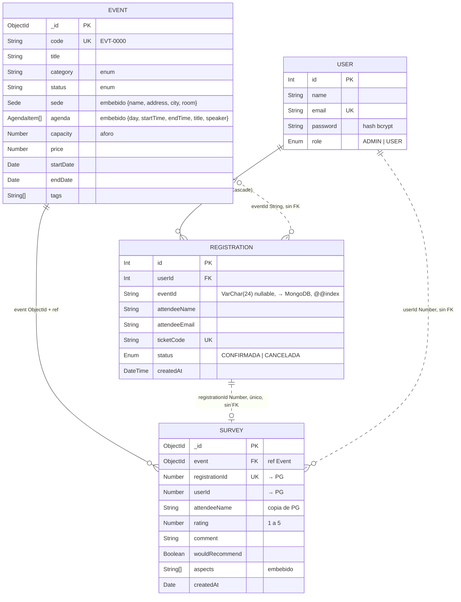

# Tarea individual U2 · Modelo híbrido PostgreSQL + MongoDB

**Estudiante:** Joselyn Isamar Morocho Quishpe **N.º de lista:** 10  **Caso:** 10 · Eventos

> Proyecto base: copia de `espe-expressjs` (Express 5, Prisma 7 y login JWT de clase). Lo nuevo del caso está en `src/models/event.js`, `src/models/survey.js`, `src/services/{event,registration,survey}Service.js`, sus controladores y rutas, y la migración `add_registrations`.
>
> Mismo formato que el workload del material de Modelado (lección 2.2) y que el ejemplo resuelto de la clínica
> (`docs/ejemplo_clinica/Workload_clinica_hibrida.md`). Cada operación agrega la fila **Base**.

| PostgreSQL (transaccional) | MongoDB: catálogo | MongoDB: registro que crece | Pista del workload |
|---|---|---|---|
| Inscripción al evento (asistente) | Evento (agenda[] embebida, sede) | Encuesta de satisfacción | El aforo es límite duro; la agenda se muestra completa |

## 1. Workload

### 1.1 Casos de uso
- Una plataforma de eventos (congresos, talleres, seminarios, conciertos y ferias) publica un catálogo de eventos. Cada evento tiene una **sede** y una **agenda** de actividades (hora de inicio, fin, título y ponente).
- El asistente busca eventos en el catálogo y abre el detalle, donde ve **la agenda completa** y los cupos que quedan.
- El asistente se **inscribe** a un evento. Cada evento tiene un **aforo**: es un límite duro, nunca puede haber más inscripciones confirmadas que cupos.
- El asistente puede cancelar su inscripción (libera el cupo) y consultar su historial de inscripciones con el nombre y la fecha de cada evento.
- Después del evento, el asistente responde una **encuesta de satisfacción** (calificación de 1 a 5, comentario, si lo recomienda y los aspectos que le gustaron). Una sola encuesta por inscripción.
- El organizador crea y edita eventos, consulta las encuestas y el promedio de cada evento, y elimina eventos que ya no se realizarán.

### 1.2 Datos principales (cuántos actores, cuántos registros, cuánto tiempo se guardan)
- Usuarios (asistentes y organizadores): ~8 000, crecen ~300 por mes.
- Eventos en el catálogo: ~30 activos a la vez, ~40 nuevos por mes. Aforo entre 20 y 2 000 personas.
- Agenda: entre 1 y 50 actividades por evento (acotada).
- Inscripciones: ~600 por día; picos de ~30 por minuto cuando se abre un evento grande.
- Encuestas: ~40 % de los asistentes responde, ~250 por día. **Crecen sin límite** (~270 000 en 3 años).
- Período: inscripciones y encuestas se guardan 3 años (reportes a patrocinadores).

### 1.3 Suposiciones (lo que puede cambiar)
- El aforo es un **límite duro**: dos personas no pueden ocupar el último cupo al mismo tiempo (integridad fuerte, concurrencia).
- Un asistente se inscribe **una sola vez** a cada evento.
- Una inscripción tiene como máximo **una** encuesta.
- Cada evento puede tener una forma distinta: un concierto no tiene ponentes, una feria tiene varios días, un taller tiene sala; la agenda cambia de tamaño entre eventos.
- El catálogo y su agenda se leen muchísimo más de lo que se escriben; el organizador edita pocas veces por semana.
- El nombre del asistente en la inscripción casi nunca cambia: se puede copiar en la encuesta.
- Las encuestas se muestran por evento, las más nuevas primero, con el promedio.

### 1.4 Operaciones

| Actor: | Asistente (o visitante) |
|---|---|
| Descripción: | Busca eventos en el catálogo por título, con proyección y orden |
| Tipo de operación: | Lectura |
| Datos en la operación: | `q` (regex sobre title), `fields` (title, code, startDate, sede…), `sort` (-startDate) |
| Frecuencia: | En cada visita a la página principal |
| Tasa: | ~20 000 / día |
| Base: | **MongoDB** (documento listo para mostrar, índice `{ category, startDate }`) |

| Actor: | Asistente |
|---|---|
| Descripción: | Abre el detalle del evento: sede, **agenda completa** y cupos disponibles |
| Tipo de operación: | Lectura |
| Datos en la operación: | Evento completo (sede y agenda embebidas) + conteo de inscripciones confirmadas |
| Frecuencia: | Antes de inscribirse, varias veces por asistente |
| Tasa: | ~12 000 / día |
| Base: | **MongoDB** (una sola lectura trae sede y agenda) + un `count` en PostgreSQL para los cupos |

| Actor: | Asistente |
|---|---|
| Descripción: | Se inscribe a un evento |
| Tipo de operación: | Escritura |
| Datos en la operación: | eventId (ObjectId como String), userId (del JWT), attendeeName, attendeeEmail, ticketCode |
| Frecuencia: | Continuo; picos al abrir eventos grandes |
| Tasa: | ~600 / día (picos de 30 / minuto) |
| Base: | **PostgreSQL** (transacción + candado por evento para no pasar el aforo); lee MongoDB para validar `eventId` y leer `capacity` |

| Actor: | Asistente |
|---|---|
| Descripción: | Ve sus inscripciones con el título, fecha y sede de cada evento |
| Tipo de operación: | Lectura |
| Datos en la operación: | Inscripciones (PostgreSQL) + code, title, startDate, sede.name (MongoDB) |
| Frecuencia: | Cada asistente activo, ~1 vez al día |
| Tasa: | ~2 000 / día |
| Base: | **Las dos**: se unen en el servicio con `$in` + `Map` (2 consultas, sin N+1) |

| Actor: | Asistente |
|---|---|
| Descripción: | Cancela su inscripción (libera el cupo) |
| Tipo de operación: | Escritura |
| Datos en la operación: | id de la inscripción, userId del JWT, status → CANCELADA |
| Frecuencia: | Ocasional |
| Tasa: | ~50 / día |
| Base: | **PostgreSQL** |

| Actor: | Asistente |
|---|---|
| Descripción: | Responde la encuesta de satisfacción de su inscripción |
| Tipo de operación: | Escritura |
| Datos en la operación: | registrationId, rating, comment, wouldRecommend, aspects[]; userId del JWT; attendeeName copiado de PostgreSQL |
| Frecuencia: | Al terminar cada evento (~40 % de los asistentes) |
| Tasa: | ~250 / día (sin límite en el tiempo) |
| Base: | **MongoDB**, colección aparte; lee PostgreSQL para validar la inscripción y su dueño |

| Actor: | Organizador (o visitante) |
|---|---|
| Descripción: | Lee las encuestas de un evento y su resumen (promedio, total, % que recomienda) |
| Tipo de operación: | Lectura |
| Datos en la operación: | attendeeName, rating, comment, createdAt + título del evento (`populate`); `aggregate` con `$avg` y `$sum` |
| Frecuencia: | Después de cada evento y en reportes |
| Tasa: | ~300 / día |
| Base: | **MongoDB** solamente (por eso se copia `attendeeName`) |

| Actor: | Organizador |
|---|---|
| Descripción: | Crea o edita un evento (agenda, sede, aforo) |
| Tipo de operación: | Escritura |
| Datos en la operación: | Todos los campos del evento; al bajar el aforo se cuenta en PostgreSQL |
| Frecuencia: | Pocas veces por semana |
| Tasa: | ~10 / día |
| Base: | **MongoDB** |

| Actor: | Organizador |
|---|---|
| Descripción: | Elimina un evento |
| Tipo de operación: | Escritura |
| Datos en la operación: | _id; conteo de inscripciones confirmadas en PostgreSQL |
| Frecuencia: | Casi nunca |
| Tasa: | ~2 / mes |
| Base: | **MongoDB**, revisando PostgreSQL (409 si hay inscritos; si no, borra sus encuestas en cascada) |

### 1.5 Entidades

- **PostgreSQL**
  - User
    - Registration (1:N, FK `userId`)
- **MongoDB**
  - Event
    - sede (1:1, embebido)
    - agenda[] (1:pocos, embebido)
    - Survey (1:N, `event` ObjectId + ref)
  - Survey
    - aspects[] (embebido)
- **Entre bases (sin FK)**
  - Registration.eventId → Event._id (String)
  - Survey.registrationId → Registration.id (Number, único)
  - Survey.userId → User.id (Number) · Survey.attendeeName (copia de Registration.attendeeName)

### 1.6 Observaciones (qué domina: lectura o escritura, qué crece sin límite, qué necesita integridad)
- Hay **~35 lecturas por cada escritura** (~34 000 lecturas frente a ~900 escrituras al día). Lo que más se lee (catálogo y detalle con agenda) tiene que salir de **un solo documento**: por eso el evento embebe su sede y su agenda.
- Lo único que crece sin límite son las **encuestas**: van en su propia colección, nunca embebidas en el evento (límite de 16 MB por documento).
- La inscripción necesita integridad fuerte: **aforo límite duro** y un asistente no se inscribe dos veces. Se queda en PostgreSQL con transacción, candado por evento (`pg_advisory_xact_lock`) y `@@unique([userId, eventId])`.
- `attendeeName` se copia en la encuesta porque la lista de encuestas se lee sin pasar por PostgreSQL y el nombre casi no cambia.
- Índices que pide el workload: `Registration.eventId` (`@@index`, cuenta cupos y protege el borrado), `@@unique([userId, eventId])` (PostgreSQL); `events.code` único, `events { category: 1, startDate: 1 }`, `surveys.registrationId` único y `surveys { event: 1, createdAt: -1 }` (MongoDB).

## 2. ¿PostgreSQL o MongoDB?

| Entidad | ¿Transacciones o choques? | ¿Otras dependen por FK? | ¿Forma variable? | ¿Crece sin límite? | ¿Se lee mucho más? | Base |
|---|---|---|---|---|---|---|
| User | Sí: correo único en el registro | Sí: Registration (FK `userId`) | No | No (crece lento) | No | **PostgreSQL** |
| Registration (Inscripción) | **Sí**: el aforo es límite duro, dos personas compiten por el último cupo; no se repite usuario+evento | Depende de User por FK | No: columnas fijas | Crece, pero acotado por el aforo de cada evento | No: se escribe en picos | **PostgreSQL** |
| Event (Catálogo) | No: lo edita un solo organizador | No por FK (las inscripciones lo referencian como String) | **Sí**: agenda de 1 a 50 actividades, sede con o sin sala, campos según categoría | No (~40 por mes) | **Sí**: ~32 000 lecturas frente a ~10 escrituras al día | **MongoDB** |
| Survey (Encuesta) | No: cada asistente escribe la suya | No | Sí: aspectos y comentario opcionales | **Sí**: ~250 por día, sin límite | Se lee por evento con promedio | **MongoDB** (colección aparte) |

## 3. Relaciones dentro de MongoDB: embeber o referenciar

| Relación | Cardinalidad | ¿Se lee junto? | ¿Cambia seguido? | ¿Crece sin límite? | Decisión |
|---|---|---|---|---|---|
| Event → sede | 1:1 | Sí, siempre en el detalle | No | No | **Embeber** (subdocumento `sede`) |
| Event → agenda | 1:pocos (1 a 50) | **Sí**: "la agenda se muestra completa" | Poco (lo edita el organizador) | No: acotada a 50 por validación | **Embeber** (`agenda: [AgendaItem]`) |
| Event → Survey | 1:muchos | No: se leen aparte, paginadas, con promedio | Sí: llegan ~250 por día | **Sí** | **Referenciar** (`Survey.event` ObjectId + `ref: "Event"`) |
| Survey → aspects | 1:pocos | Sí | No | No (máximo 5 valores del enum) | **Embeber** (`aspects: [String]`) |

## 4. ERD híbrido (notación pata de gallo, como el material 2.1)

Línea continua: FK de PostgreSQL o `ref` de Mongoose. **Línea punteada: referencia entre bases** (sin FK).

## 5. Referencias

| Referencia | Se guarda como | La garantiza | Se une con |
|---|---|---|---|
| Registration.userId → User.id | `Int` + FK | PostgreSQL (FK, `onDelete: Cascade`) | Prisma `include` / `where` |
| Registration.eventId → Event._id | `String? @db.VarChar(24)` + `@@index` | El servicio de inscripciones: `isValidObjectId` + `Event.findById` (400 / 404) antes de crear | `$in` + `Map` en `GET /api/registrations/me` |
| Survey.event → Event._id | `ObjectId` + `ref: "Event"` | Mongoose (se toma del `eventId` de la inscripción ya validada) y el borrado protegido | `populate("event", "code title")` |
| Survey.registrationId → Registration.id | `Number`, índice único | El servicio de encuestas: `prisma.registration.findUnique` (404) y dueño = userId del JWT (403) | Búsqueda por id en Prisma |
| Survey.userId → User.id | `Number` | Sale del JWT, nunca del body | Prisma `findUnique` si se necesita |

## 6. Dato copiado entre bases (desnormalización)

- **Dato:** `attendeeName` (nombre del asistente) se copia de `Registration.attendeeName` (PostgreSQL) a `Survey.attendeeName` (MongoDB) al crear la encuesta.
- **Por qué (operación del workload):** la lista de encuestas de un evento (~300 lecturas al día) se responde solo con MongoDB; sin la copia habría que ir a PostgreSQL por cada lista para traer los nombres.
- **Costo:** si el asistente cambia su nombre, las encuestas viejas guardan el anterior (se acepta: el nombre casi no cambia y la encuesta es un registro histórico). Además ocupa un poco más de espacio por documento.

### Qué pasa si una base falla a la mitad
- **Inscribir:** primero se lee MongoDB (no escribe nada). Si MongoDB falla → 503 y no se crea nada en PostgreSQL. La escritura en PostgreSQL es una sola transacción: o se crea completa o no se crea.
- **Encuesta:** primero se lee PostgreSQL y al final se escribe en MongoDB. Si MongoDB falla al escribir, no queda nada a medias.
- **Borrar evento:** orden 1) borrar encuestas (MongoDB), 2) desligar inscripciones canceladas (`eventId = null`, PostgreSQL), 3) borrar el evento (MongoDB). Si falla a la mitad, el evento sigue existiendo y se puede volver a ejecutar el DELETE (la operación es repetible), nunca quedan encuestas apuntando a un evento borrado.
- **Aforo y PUT:** si el organizador baja el aforo, el servicio cuenta las confirmadas en PostgreSQL y responde 409 si el nuevo aforo es menor.

## 7. Endpoints

| Método y ruta | Base(s) | Respuestas posibles |
|---|---|---|
| `POST /api/auth/register` | PostgreSQL | 201, 400, 409 |
| `POST /api/auth/login` | PostgreSQL | 200, 400, 401 |
| `GET /api/auth/me` (JWT) | PostgreSQL | 200, 401, 403 (token inválido) |
| `DELETE /api/auth/me` (JWT) | Las dos (cascada en PG, borra encuestas en Mongo) | 200, 401 |
| `GET /api/events?q=&fields=&sort=&category=` | MongoDB | 200, 400 |
| `GET /api/events/:id` | MongoDB + count en PostgreSQL | 200, 400, 404 |
| `POST /api/events` (JWT) | MongoDB | 201, 400, 401, 409 (code duplicado) |
| `PUT /api/events/:id` (JWT, `findById` + `save()`) | MongoDB (+ count en PG si cambia el aforo) | 200, 400, 401, 404, 409 |
| `DELETE /api/events/:id` (JWT) | MongoDB revisando PostgreSQL | 200, 400, 401, 404, 409 |
| `GET /api/events/:id/surveys?sort=&limit=` | MongoDB (`populate`) | 200, 400, 404 |
| `GET /api/events/:id/surveys/summary` | MongoDB (`aggregate`) | 200, 400, 404 |
| `POST /api/registrations` (JWT) | PostgreSQL validando MongoDB | 201, 400, 401, 404, 409 (duplicada o aforo completo) |
| `GET /api/registrations/me` (JWT) | Las dos (`$in` + `Map`) | 200, 401 |
| `GET /api/registrations/:id` (JWT) | Las dos | 200, 400, 401, 403, 404 |
| `PATCH /api/registrations/:id/cancel` (JWT) | PostgreSQL | 200, 401, 403, 404, 409 |
| `POST /api/surveys` (JWT) | MongoDB validando PostgreSQL | 201, 400, 401, 403, 404, 409 (E11000) |
